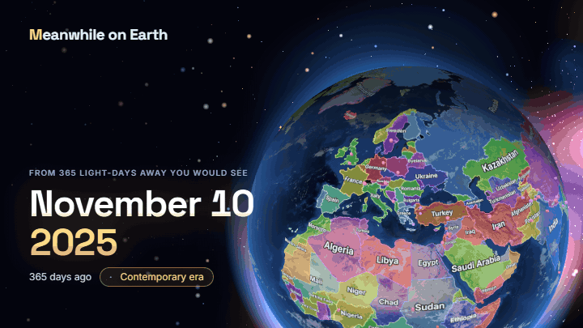
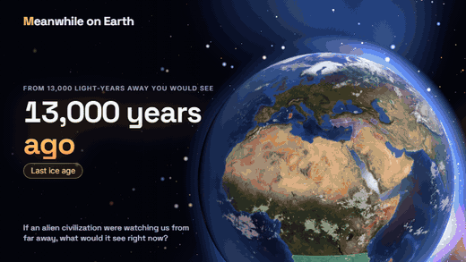
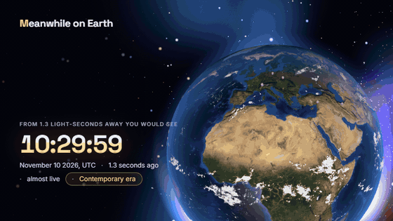

# Meanwhile on Earth

[](https://deemonder.github.io/meanwhile-on-earth/)

**If an alien civilization were watching Earth from far away, what would it see right now?**

**[Try the live demo →](https://deemonder.github.io/meanwhile-on-earth/)**

Light takes one year to cross one light-year. An observer 2,000 light-years away is receiving, today, the light that left Earth 2,000 years ago: they are watching the Roman Empire under Tiberius, while the Han rule China and the Maya build cities in Central America.

Meanwhile on Earth is a 3D globe that shows that view. Pick a distance, aim at a place, and see what was there when the light left. The name is the joke: for someone that far away, "meanwhile" is two thousand years ago.

*Italiano più sotto.*

## What it does

- **Distance slider** from the Moon (1.3 light-seconds) to beyond the age of the Universe, with half of the track given to recorded history.
- **Aim anywhere.** The crosshair in the middle of the globe is the spot being watched. The panel names the state or culture that held it at the time, with a short introduction from Wikipedia.
- **Historical borders** for 53 dates between 123,000 BC and 2010, drawn on the globe and labelled.
- **Events of the time**: battles, eruptions, earthquakes, treaties, cities and universities founded, monuments built, famous births. Each one is a dot on the globe and a link to Wikipedia.
- **Real day and night.** The terminator is where it actually was when the light left. City lights appear only after electricity does.
- **A planet, not a map.** Drifting clouds and their shadows, mountain relief, the Sun glinting off the oceans, and an atmosphere that glows at the limb and reddens at dusk. The historical borders are a layer you can switch off.
- **Journey through time.** One button drifts you away from Earth and plays history backwards, from today to before the planet formed. It steps through distances whose light left at the same time of day, so the Sun stays put while the centuries change.
- **Real vantage points.** Choose Vega, Polaris, the Pleiades or another star, and the camera moves to the side of Earth that faced it at that moment. The star appears in the sky by name, and rings mark the point that has it overhead.
- **Continental drift.** Beyond five million years the continents move to where plate reconstructions put them: India adrift in the ocean, the Atlantic closing, Pangaea, and on back to a billion years ago.
- **Deep time.** Ice ages, Snowball Earth, the oxygen-free Archean, the molten Hadean, and the time before Earth existed.
- **A reality check**: the panel says how large a telescope mirror would have to be. From 2,000 light-years it is 1.3 billion km across, 8.5 times the distance from Earth to the Sun.
- Italian and English. Every view has a shareable link.

## See it move

Keep going and the planet itself changes: ice sheets, continents sliding back into Pangaea, a frozen world, green seas, a magma ocean, and then no Earth at all.



With the borders switched off it is just the planet, lit from where the Sun really is, with city lights on the night side.



## Run it

```bash
npm install
npm run dev
```

Other commands:

| Command | What it does |
| --- | --- |
| `npm run build` | Builds the static site into `dist/` (works on GitHub Pages) |
| `npm test` | Checks the astronomy against worked examples from Meeus |
| `npm run build-events` | Rebuilds `public/data/events.json` from Wikidata |
| `npm run build-continents` | Rebuilds the continental-drift outlines from the GPlates Web Service |
| `npm run audit-borders` | Measures where the historical maps contradict each other; `-- --write` rebuilds `public/data/carried/` and the added territories |

Two things a link can ask for: `?lang=en` or `?lang=it` sets the language, and `?poster=1200x630` shows only the planet and the headline at that size, for screenshots. The link-preview image was made that way, and so were the animations: `npm run make-media` photographs the app frame by frame with a headless browser and joins the frames with ffmpeg. A third parameter, `?at=2026-11-10T10:30:00Z`, freezes the clock so every frame shows the same instant.

## How it works

**The moment.** The light arriving now at distance *d* light-years left Earth *d* Julian years ago. All time arithmetic uses Julian Dates, so it works billions of years back. Dates before 1582 are shown in the Julian calendar, as historians write them.

**Day and night.** The Sun's position comes from the low-precision solar theory in Meeus, *Astronomical Algorithms*. Earth's rotation angle comes from sidereal time, corrected for ΔT: tides slow the planet down, and over 2,000 years the drift adds up to about 43° of rotation.

**Which side faces the star.** A star's J2000 coordinates are precessed to the date in question (in Roman times Polaris sat 12° from the pole). The point on Earth with the star overhead is the centre of the hemisphere the observer sees.

**Borders** are painted onto a texture and wrapped around the globe, so moving through the centuries stays smooth. There are two textures per layer: the next map is painted onto the hidden one and then dissolves in, and drifting continents blend from one reconstruction to the next. Finding the territory under the crosshair is a point-in-polygon test.

**Events** are fetched from Wikidata once, by `scripts/build-events.mjs`, and shipped as a static file. A live query from the browser would take tens of seconds.

## What is simplified

- **Nobody could build that telescope.** The site imagines a perfect one. The mirror size shown is the diffraction limit for resolving 10 metres.
- **Rotation is unknown beyond about 6,000 years.** ΔT is extrapolated from ancient eclipse records. Further back the day/night lighting is indicative, and the site says so.
- **Borders are snapshots, and the snapshots disagree.** The nearest of 53 maps is used, and its year is shown. The maps were drawn one at a time: the share of land that carries a name swings from 62% to 100% between them, so a land can be named in one map, blank in the next and named again later. Where a map is blank, the site shows the last holder named by an earlier map, and says so. It does this when that map is at most 300 years older, or when the gap closes: a later map names the place again within 600 years of the earlier one. Of 2,190 places that would otherwise blink out for a map, 81 are left, all before 2000 BC, where the maps are thousands of years apart and a blank is honest ignorance (`npm run audit-borders` measures this and rebuilds the fill-ins). Carried names can be out of date: they are the last ones the maps give. Land with no record at all is tinted grey.
- **Disputed territories follow the sources.** Kosovo is missing from the 2010 map, so it is added from Natural Earth and labelled as disputed. Other disputes are shown however the dataset draws them.
- **Drifting continents keep today's coastlines.** The plate model moves the present-day outlines; the true shorelines of the time are lost. Land colours follow latitude, not the real climate of the period, and the ice sheets are a sketch.
- **Nobody knows the map beyond a billion years.** Further back the oldest reconstruction stays on screen, and the site says so.
- **Cosmological distances** mean light-travel time here, not comoving distance.
- **Events are what Wikidata has**, and it knows Europe better than the rest of the world. The number of dots says as much about the database as about history. Births between 1960 and 1990 are missing from the current snapshot because those queries timed out.
- **The star field is decorative.** Only the Sun and the observer's star are in their true directions.
- **Clouds are one modern snapshot**, drifting slowly. Nobody knows the weather of AD 26.
- **City lights** fade in between 1880 and 2000 using a modern night image. They cannot show which cities were lit first.

## Data and credits

| Source | Used for | Licence |
| --- | --- | --- |
| [Wikidata](https://www.wikidata.org) | Events | CC0 |
| [Wikipedia](https://www.wikipedia.org) | Introductions and images, loaded on demand | CC BY-SA |
| [historical-basemaps](https://github.com/aourednik/historical-basemaps) by André Ourednik | Historical borders, loaded from a CDN at run time | GPL-3.0 |
| [GPlates Web Service](https://gws.gplates.org), plate model of Müller et al. 2022 | Continental drift, prebuilt into `public/data/continents/` | CC BY 4.0 |
| [Natural Earth](https://www.naturalearthdata.com) | Territories missing from the historical maps (Kosovo) | Public domain |
| [NASA Visible Earth](https://visibleearth.nasa.gov) | Earth textures, via [three-globe](https://github.com/vasturiano/three-globe) | Public domain |
| [globe.gl](https://globe.gl) and [three.js](https://threejs.org) | 3D rendering | MIT |

Astronomy: Jean Meeus, *Astronomical Algorithms*, 2nd ed.; Morrison & Stephenson (2004) for ΔT. Plate motions: Müller et al., "A tectonic-rules-based mantle reference frame since 1 billion years ago", *Solid Earth* 13 (2022).

## Licence

The code is released under the [MIT licence](LICENSE), © 2026 Filippo Iori. The data sources keep their own licences, listed above.

---

## In italiano

**Se una civiltà aliena ci stesse osservando da lontano, cosa vedrebbe in questo momento?**

La luce impiega un anno a percorrere un anno luce. Chi ci osserva da 2.000 anni luce riceve oggi la luce partita dalla Terra 2.000 anni fa: sta guardando l'Impero romano di Tiberio, mentre gli Han governano la Cina e i Maya costruiscono città in America centrale.

Meanwhile on Earth («Nel frattempo sulla Terra») è un globo 3D che mostra quella vista. Scegli una distanza, punta un luogo e guarda cosa c'era quando la luce è partita.

- **Cursore della distanza**, dalla Luna fino a oltre l'età dell'Universo.
- **Punta dove vuoi**: il mirino al centro è il luogo osservato. Il pannello dice quale stato o cultura c'era, con un'introduzione da Wikipedia.
- **Confini storici** per 53 date, dal 123.000 a.C. al 2010.
- **Eventi del periodo** presi da Wikidata: battaglie, eruzioni, terremoti, trattati, fondazioni, nascite celebri.
- **Giorno e notte reali**, calcolati per l'istante in cui la luce è partita. Le luci delle città compaiono solo dopo l'elettricità.
- **Un pianeta, non una mappa**: nuvole, rilievi, riflesso del Sole sugli oceani e atmosfera. I confini storici si possono spegnere.
- **Viaggio nel tempo**: un pulsante ti allontana dalla Terra e fa scorrere la storia all'indietro.
- **Punti di osservazione reali**: scegli Vega, la Stella Polare o le Pleiadi, e la vista si sposta sul lato della Terra che era rivolto verso quella stella.
- **Deriva dei continenti**: oltre i cinque milioni di anni i continenti si spostano dove li collocano le ricostruzioni delle placche, fino alla Pangea e a un miliardo di anni fa.
- **Tempo profondo**: glaciazioni, Terra palla di neve, Archeano, Adeano, e il periodo in cui la Terra non esisteva.

Provalo subito: **[demo online](https://deemonder.github.io/meanwhile-on-earth/)**. Per avviarlo sul tuo computer: `npm install`, poi `npm run dev`.

Il telescopio necessario non si può costruire: da 2.000 anni luce servirebbe uno specchio largo 1,3 miliardi di km, 8,5 volte la distanza tra la Terra e il Sole. Il sito immagina che esista.
